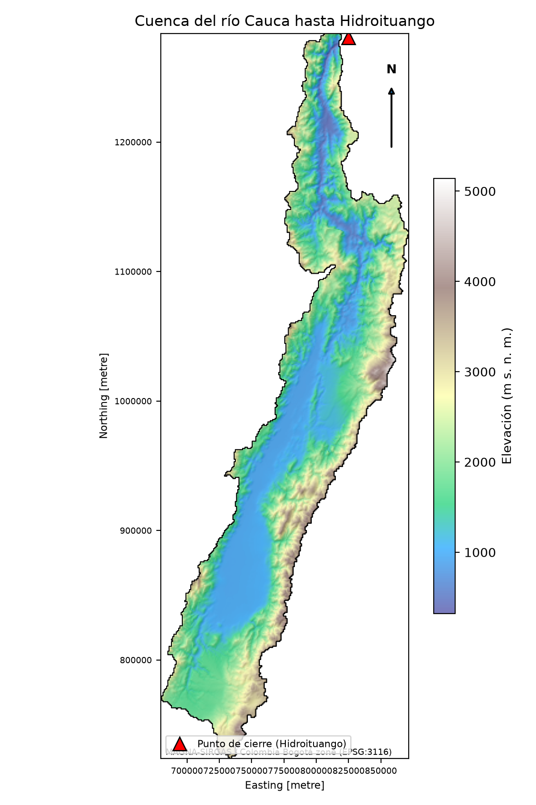

# Balance hídrico de largo plazo · Río Cauca hasta Hidroituango

Trabajo 1 de **Hidroclimatología** — Universidad Nacional de Colombia, 2026-II.

Balance hídrico de largo plazo (1981–2010) de la cuenca del río Cauca con cierre en el sitio de presa de Hidroituango, y evaluación de tres productos de precipitación (CHIRPS, ERA5 y ERA5-Land) frente a la información de estaciones del IDEAM.

**🌐 Sitio web con los resultados:** https://damorenoy.github.io/balance-hidrico-cauca-hidroituango/



## La cuenca en cifras

| | |
|---|---|
| Área | 35 283 km² |
| Elevación | 322 a 5 141 m s. n. m. (media 1 795 m) |
| Periodo de análisis | 1981–2010 (anterior al embalse) |
| Sistema de referencia | MAGNA-SIRGAS / Colombia Bogotá zone (EPSG:3116) |
| DEM | mdt900 (celdas de ≈ 930 m) |

## Contenido del análisis

| # | Tema | Notebook |
|---|---|---|
| 1–2 | Selección y delimitación de la cuenca (GRASS en QGIS) | [`01_QGS`](Desarrollo/01_QGS) |
| 3 | Precipitación media anual interpolada (kriging, validación cruzada) | [`punto3_precipitacion_IDEAM.ipynb`](Desarrollo/04_PY/punto3_precipitacion_IDEAM.ipynb) |
| 4 | Temperatura vs. elevación (T = T₀ − αZ) | [`punto4_temperatura_elevacion.ipynb`](Desarrollo/04_PY/punto4_temperatura_elevacion.ipynb) |
| 5 | Mapas de Tmax, Tmed, Tmin y pisos térmicos | [`punto5_mapas_temperatura.ipynb`](Desarrollo/04_PY/punto5_mapas_temperatura.ipynb) |
| 6–7 | ETP (Hargreaves-Samani) y ETR (Budyko) | [`punto6_7_ETP_ETR.ipynb`](Desarrollo/04_PY/punto6_7_ETP_ETR.ipynb) |
| 8 | Caudales observados y áreas de drenaje | [`punto8_caudales.ipynb`](Desarrollo/04_PY/punto8_caudales.ipynb) |
| 9–12 | Balance hídrico y evaluación de productos | [`punto9_12_balance.ipynb`](Desarrollo/04_PY/punto9_12_balance.ipynb), [`punto10_11_productos.ipynb`](Desarrollo/04_PY/punto10_11_productos.ipynb) |
| 13–14 | Climatología mensual y ciclo anual entre productos (diagrama de Taylor) | [`punto13_14_ciclo_anual.ipynb`](Desarrollo/04_PY/punto13_14_ciclo_anual.ipynb) |
| — | Generación del sitio web | [`sitio_web_resultados.ipynb`](Desarrollo/04_PY/sitio_web_resultados.ipynb) |

## Resultado principal

Balance en el cierre (Cañafisto, 32 556 km², 92 % de la cuenca):

| Fuente de P | P (mm/año) | ETR (mm/año) | Q estimado (mm/año) | Q observado (mm/año) | Error |
|---|---:|---:|---:|---:|---:|
| IDEAM | 2 000.7 | 1 075.7 | 924.9 | 884.3 | +4.6 % |
| CHIRPS | 2 031.5 | 1 092.6 | 938.9 | 884.3 | +6.2 % |
| ERA5-Land | 6 197.0 | 1 297.9 | 4 899.1 | 884.3 | +454.0 % |
| ERA5 | 6 225.3 | 1 300.4 | 4 924.9 | 884.3 | +456.9 % |

**CHIRPS** es el producto que mejor reproduce el balance observado (error absoluto medio de 6.0 % en 9 estaciones) y el más parecido a la lluvia del IDEAM. Todas las fuentes sobrestiman el caudal en el cierre, lo que apunta a una ETR subestimada o a extracciones y pérdidas que el balance no considera.

## Estructura del repositorio

```
└── Desarrollo/
    ├── 01_QGS/                 Proyecto QGIS y capas de la delimitación
    ├── 02_VECTORIAL/           Polígono de la cuenca
    ├── 03_RASTER/              DEM recortado, dirección y acumulación de flujo
    ├── 04_PY/                  Notebooks, rásteres y tablas de resultados, figuras
    │   ├── caudales/           Caudales medios diarios por estación
    │   ├── productos/          CHIRPS, ERA5 y ERA5-Land recortados a la cuenca
    │   └── sitio/              Sitio web (index.html + img/)
    └── PNG/                    Mapa general de la cuenca
```

## Cómo reproducir

1. Instalar Python 3.10+ y las dependencias:

   ```bash
   pip install numpy pandas scipy matplotlib xarray netCDF4 rasterio geopandas shapely pyproj pillow requests cdsapi jupyter
   ```

2. Los datos crudos entregados en el curso (DEM mdt900, red de drenaje, caudales, climatología IDEAM y productos de precipitación para toda Colombia) no se incluyen en el repositorio. Sí están todos los insumos ya procesados para la cuenca: DEM recortado, caudales por estación (`Desarrollo/04_PY/caudales`), promedios climatológicos del IDEAM y CHIRPS, ERA5 y ERA5-Land recortados a 1981–2010 (`Desarrollo/04_PY/productos`), así que los notebooks de resultados corren con lo que hay aquí.
3. Ejecutar los notebooks de `Desarrollo/04_PY` en el orden de la tabla. Algunos contienen rutas absolutas de la máquina original (`C:\Users\...`); ajústelas a la ubicación local del repositorio.

## Sitio web

El sitio es un único `index.html` estático con las figuras en `img/`. Se publica automáticamente en GitHub Pages con el workflow [`.github/workflows/pages.yml`](.github/workflows/pages.yml) cada vez que cambia la carpeta `Desarrollo/04_PY/sitio`. Para verlo localmente basta abrir `Desarrollo/04_PY/sitio/index.html` en el navegador.

## Fuentes de información

- IDEAM – Promedios climatológicos 1981–2010 (precipitación y temperatura).
- IDEAM – Caudales medios diarios y Catálogo Nacional de Estaciones (datos.gov.co).
- Funk et al. (2015) – CHIRPS v2.0, Climate Hazards Center (UCSB).
- Muñoz-Sabater et al. (2021) – ERA5-Land; Hersbach et al. (2020) – ERA5. Copernicus Climate Data Store.
- Hargreaves y Samani (1985); Budyko (1974); Taylor (2001).

## Contacto

damorenoy@unal.edu.co
